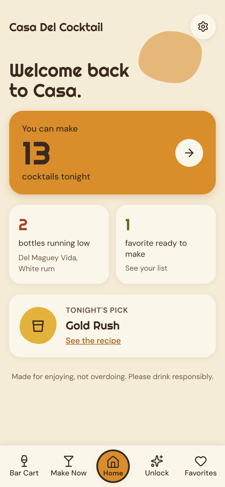
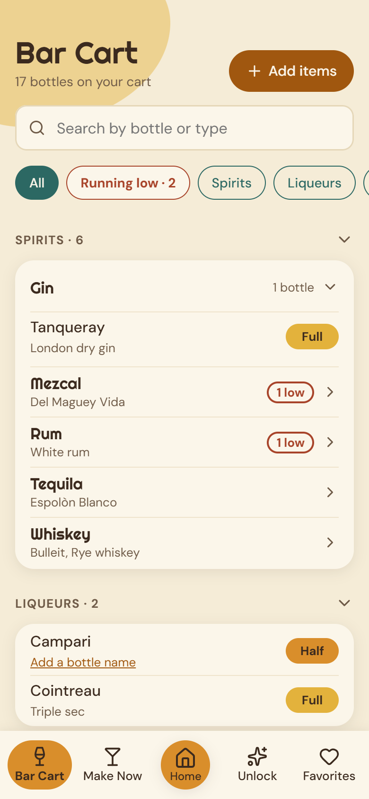
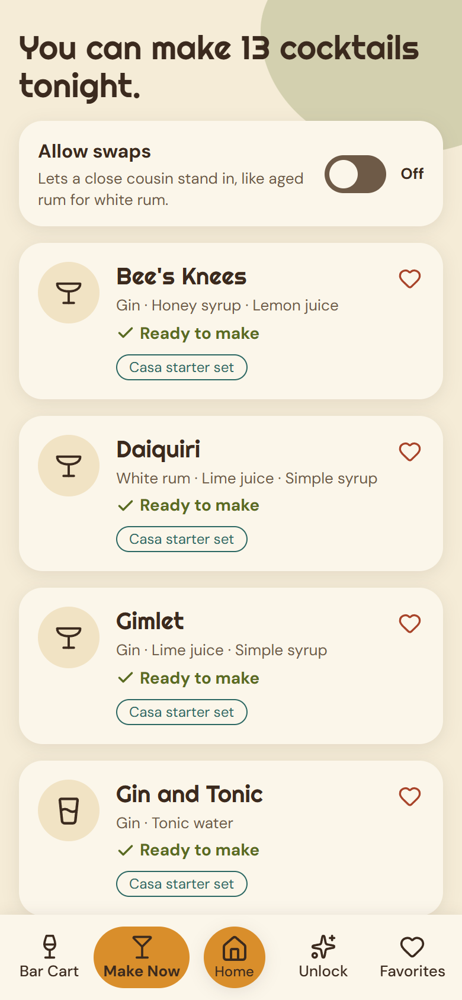
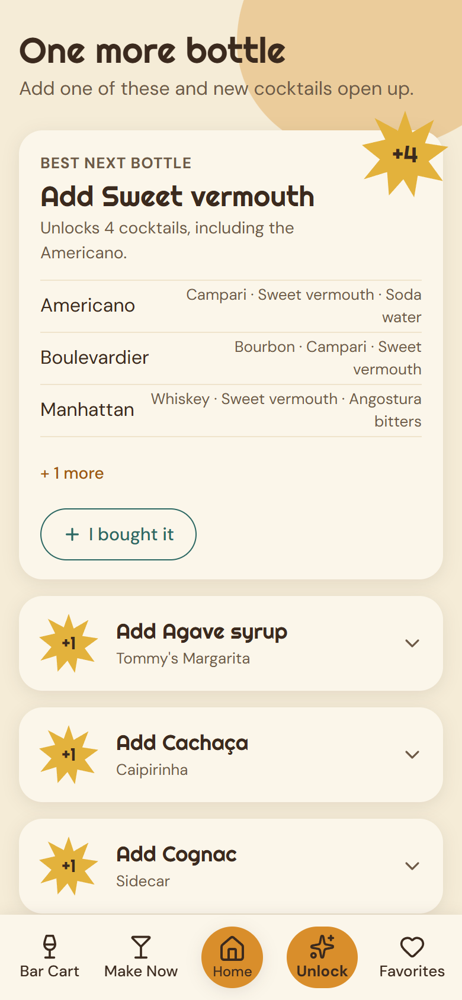
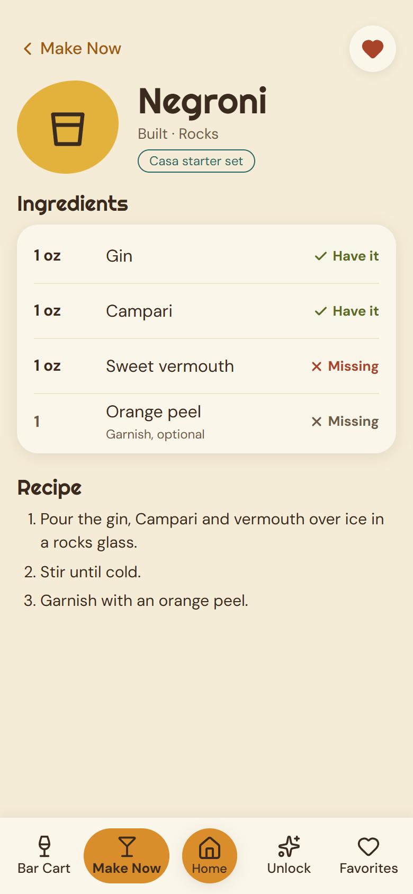

# Casa Del Cocktail

A virtual bar cart. Add the bottles on your cart, and Casa shows which cocktails you can make tonight and which one more bottle would open up the most new ones.

It runs entirely in your browser. There is no server and no account.

**[Try the live demo](https://osanchezchristensen.github.io/Casa_Del_Cocktail/)**: open the Bar Cart and tap **Try a sample cart** to see it in action.

| Home | Bar Cart | Make Now | Unlock | Recipe |
|---|---|---|---|---|
|  |  |  |  |  |

## What it does

- **Bar Cart:** add bottles by search or by browsing categories, give them a name ("Bulleit"), and track each one as Full, Half, Low or Empty.
- **Make Now:** every cocktail you can make right now, with the full recipe one tap away.
- **Unlock:** the top 10 bottles to buy next, ranked by how many new cocktails each one opens up.
- **Favorites:** save recipes with the heart, split into "Ready to make" and "Missing something."
- **Settings:** switch on Allow swaps, and export or import a backup of your cart.

It comes with 60 classic cocktails, written in our own words.

## Running it

You need [Node.js](https://nodejs.org) (version 22.12 or newer).

```sh
npm install
npm run dev      # start the app at http://localhost:5173
npm test         # run the tests
npm run build    # production build (also checks types)
npm run lint     # check the code for common mistakes
```

## How matching works

- A general recipe ingredient matches a specific bottle: a recipe asking for "rum" is happy with your dark rum.
- A specific ingredient needs an exact match: "white rum" isn't filled by dark rum...
- ...unless **Allow swaps** is on. Then a close cousin in the same family can stand in, and the recipe is labeled as a swap. Swaps never cross families (rum never replaces gin), and a few ingredients, like sweet and dry vermouth, never swap.
- Garnishes, optional ingredients and basics (ice, water, sugar, salt) are ignored.
- Full, Half and Low count as owned. **Empty doesn't.**

The full rules are in [`docs/prd.md`](docs/prd.md), section 7. The logic lives in [`src/logic/matching.ts`](src/logic/matching.ts) and is covered by tests.

## Your data

Your cart, favorites and settings are saved in this browser (localStorage) and are never sent anywhere. Clearing the browser's site data clears your cart, so use **Settings → Export my cart** now and then to save a backup file.

## Adding recipes from your own books

Recipes from cookbooks are copyrighted, so they stay out of this repository. Put them in `src/data/private/`, which is git-ignored, as files named `recipes-book-<anything>.json`. Each file is a list of recipes in the same format as [`src/data/recipes-starter.json`](src/data/recipes-starter.json), with a book source:

```json
"source": { "type": "book", "title": "Book Title", "author": "Author Name", "page": 42 }
```

Ingredients must use ids from [`src/data/ingredients.json`](src/data/ingredients.json). Run `npm test` afterwards: a data check catches unknown ids and missing fields. The app works normally when the folder is empty or missing.

## How I built it

I planned it before writing code: a project brief, a PRD with user stories and exact matching rules, a brand kit ("Atomic Garden": mid-century colors, rounded shapes, a friendly-host voice) and HTML mockups of every screen. Then I built it one small roadmap step at a time with [Claude Code](https://claude.com/claude-code), reviewing a plan before each step and logging every product decision with its reason.

Things I'm happy with:

- **The matching logic is plain TypeScript with no React in it**, so it's easy to test. Every matching rule has a test (99 tests in all), including data checks that every recipe uses real ingredient ids.
- **Ingredients form a family tree** (rum → white rum, aged rum, ...), which makes "general recipe ingredient matches a specific bottle" and "swaps stay inside a family" simple tree lookups.
- **Search is accent-insensitive**: "cachaca" finds Cachaça and "anejo" finds Añejo tequila.
- **Copyrighted recipes never touch git.** Book recipes load from a git-ignored folder at build time, and the app works the same without them.
- **Accessible by default:** status is never shown by color alone (every chip has a word or icon), sheets use the native `<dialog>`, and the brand colors are contrast-checked.

## Built with

Vite, React, TypeScript, React Router, Zustand (saved with `persist`), plain CSS with CSS Modules, Lucide icons and Vitest. It's deployed to GitHub Pages by a GitHub Actions workflow that runs the tests first.

## Docs

Planning documents live in [`docs/`](docs/Home.md): the [project brief](docs/project-brief.md), [PRD](docs/prd.md), [brand kit](docs/brand-kit.md), [roadmap](docs/roadmap.md) and [decision log](docs/decisions.md). HTML mockups of every screen are in [`docs/screens/`](docs/screens/README.md).

## License

[MIT](LICENSE)

Made for enjoying, not overdoing. Please drink responsibly.
